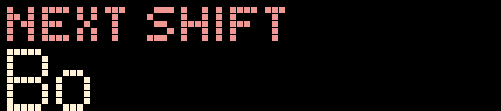
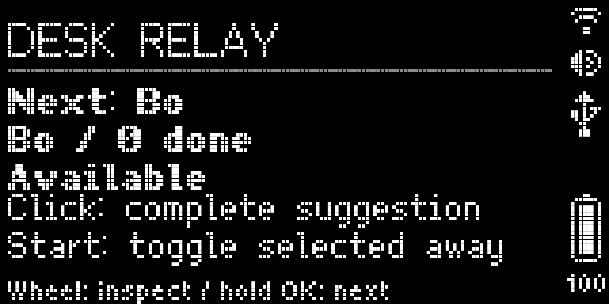

# Desk Relay

Give the next desk shift to an available person with the fewest completed turns.

Keep the bar by the shared desk. Anyone can see who takes the next shift, and someone coming back from lunch keeps credit for the shifts they have already covered.

## Screen transitions

Follow the turn indicator as the desk passes to another person.



<details>

<summary>Watch the rear display</summary>



</details>

## Hand the desk to the next person

1. Set the three names in the app settings. The defaults are Ari, Bo and Cam.
2. Read **Next shift** when someone needs to cover the desk. The rear screen shows the suggested name and completed count.
3. At the end of that shift, click the wheel once. Desk Relay adds one to that person’s count and shows the next suggestion.


## Take someone out of the rotation

1. Turn the wheel until **Team member** shows the person heading out. Check the rear screen for their current availability.
2. Press **Start** to mark that person away. The same button makes them available when they return.
3. Hold the wheel to get back to **Next shift**. A short click here records a completed shift for the suggested person, even if you were looking at someone else.


## How a tie is settled

The app first looks for the lowest completed count among available people. With two people tied, it starts looking just beyond whoever finished last. For example, if Ari has covered two shifts, Bo one and Cam three, Bo is next while available. If Bo steps out, Ari becomes the suggestion. Returning Bo to the rotation restores their count of one.

When everyone is away, the front reads **All away**. Turn the wheel to pick a name and press **Start** to put that person back in rotation.

## Run in the emulator

Open BUSY Bar Emulator. From this repository, run:

```sh
~/.busy-emulator/bin/busy-emulator dev --once
```

Press **Back** to exit.

The GIFs are excerpts from the emulator recording. Each LED occupies a 16 × 16 cell with a black border. The end frames pause for reading.

[Full recording](media/controls.mp4) · [Rear display](screenshots/back-1.png) · [Firmware test](EMULATOR-QA.md) · [MIT license](LICENSE)

## Device settings

Open **Apps → Desk Relay → Setup**. Save the fields and reopen the app to use the new values.

- **Person 1** (`person0`). Default: `Ari`.
- **Person 2** (`person1`). Default: `Bo`.
- **Person 3** (`person2`). Default: `Cam`.
